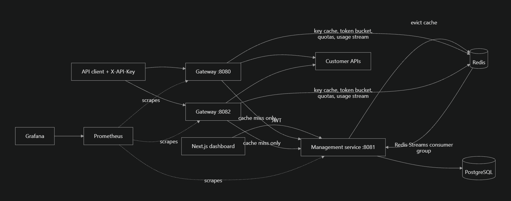

# APIForge
 
**A multi-tenant API management platform with distributed rate limiting.** Companies register an API, issue keys to their customers, set limits and quotas, and watch traffic. It is a small, readable version of what Kong or AWS API Gateway do.
 
[](https://github.com/Isha2790/APIForge/actions/workflows/ci.yml)
 
**Stack:** Java 21, Spring Boot 3.3, Spring Cloud Gateway, PostgreSQL, Redis (Lua scripts and Streams), Next.js 15, Docker Compose, GitHub Actions, Prometheus, Grafana, k6.
 
## Features
 
- **API gateway:** one `/proxy/{apiId}/**` route that checks the key, then forwards to the customer's real API.
- **Distributed rate limiting:** token bucket in Redis, updated by an atomic Lua script, so limits hold across any number of gateway instances.
- **Quotas:** daily and monthly limits per key.
- **Key lifecycle:** keys are shown once and stored only as SHA-256 hashes. Keys can be scoped to methods and path prefixes, expire, be revoked immediately, or be rotated with a grace period.
- **Caching with exact eviction:** key validation is cached in Redis. Revoking or rotating evicts the entry, and a TTL of at most 60 seconds is the safety net.
- **Multi-tenancy and roles:** organizations with OWNER, ADMIN and MEMBER roles, and email-bound, single-use invitations.
- **Analytics:** gateways publish usage events to a Redis Stream. A worker rolls them up into hourly rows in PostgreSQL for the dashboard.
- **Security:** JWT login, BCrypt passwords, login lockout, SSRF protection on upstream URLs, path-traversal rejection, and credential headers stripped before forwarding.
- **Email:** password reset by emailed single-use link and invitation emails (Mailpit in development, any SMTP server in production).
- **Operations:** Docker Compose stack, Prometheus metrics, a Grafana dashboard, and GitHub Actions CI.
## Architecture

 
- **Control plane (`management/`):** a Spring MVC service for accounts, organizations, APIs, keys, analytics and email. It uses PostgreSQL as the source of truth.
- **Data plane (`gateway/`):** a stateless reactive service. Any number of instances share their state through Redis, so they scale horizontally.
- The database stays off the request path: a request on a cached key touches Redis, not PostgreSQL.
## Quick start
 
You need Docker Desktop (or Docker Engine with Compose) and `bash`.
 
```bash
bash scripts/gen-env.sh        # creates .env with random secrets
docker compose up --build      # first build takes several minutes
```
 
| What | Where |
|---|---|
| Dashboard | http://localhost:3000 |
| Gateways | http://localhost:8080 and http://localhost:8082 |
| Dev inbox (Mailpit, shows password-reset and invitation emails) | http://localhost:8025 |
 
Stop with `docker compose down`. Start again later with `docker compose up -d`.
 
## Try it
 
1. Open the dashboard, register an account and create an organization.
2. Register an API with the upstream `http://demo-api:5678` (a built-in test container).
3. Create a key and copy it, because it is shown once.
4. Call the gateway:
```bash
curl -i -H "X-API-Key: af_YOUR_KEY" http://localhost:8080/proxy/YOUR_API_ID/hello
```
 
You get `200` with `X-RateLimit-Limit` and `X-RateLimit-Remaining` headers. Send requests faster than the limit and you get `429` with `Retry-After`. Revoke the key and the next call returns `401`.
 
## Tests
 
- `bash scripts/smoke.sh` walks the whole product through real HTTP calls: limits shared across two gateways, quotas, scope, key rotation, revocation, roles, invitations, analytics, and password reset by email.
- `bash scripts/distributed-check.sh` shows that one limit holds across both gateways.
- `mvn -B verify` runs the unit tests and the integration tests, which start real PostgreSQL and Redis with Testcontainers (Docker required). GitHub Actions runs this on every push, along with the frontend type-check, the production build and the Docker image builds.
## Load test results
 
Measured with k6 (`loadtest/k6.js`, 60 seconds per run) against a key limited to 100,000 requests per minute and a trivial echo upstream.
 
| Setup | Target rate | Achieved | p95 latency | Errors |
|---|---|---|---|---|
| 2 gateways | 100/s | 100/s | about 7 ms | 0% |
| 2 gateways | 500/s | 499/s | 6.1 ms | 0% |
| 2 gateways | 1,000/s | 998/s | 8.8 ms | 0% |
| 2 gateways | 1,500/s | 1,490/s | 18.5 and 21.1 ms (two runs) | 0% |
| 2 gateways | 2,000/s (peak, short run) | 1,987/s | 52.7 ms | 0% |
| **1 gateway** | 1,500/s | 1,183/s | **513 ms** | 0.57% |
 
Latency stays flat up to about 1,000 requests per second. At 1,500 requests per second, two gateways cope and a single gateway falls behind, which shows that adding a stateless gateway instance restores performance. During the 1,500/s run both gateways used about 2 CPU cores each, Redis about 80% of one core, and PostgreSQL was nearly idle.
 
**Caveats:** everything ran on one Windows laptop (Docker Desktop with 16 logical CPUs and about 7.5 GiB of memory), with k6 on the same machine, so treat these as lower bounds for relative comparison and not as production capacity. The 2,000/s run is a short burst, because it approaches the key's own 100,000-per-minute limit.
 
## Project layout
 
```
gateway/        Spring Cloud Gateway: key lookup, rate limit and quota scripts, usage events
management/     Spring Boot service: auth, organizations, keys, analytics, email, Flyway migrations
frontend/       Next.js dashboard
scripts/        smoke test, two-gateway check, .env generator
loadtest/       k6 script and notes
observability/  Prometheus and Grafana configuration
docs/           interview notes and deployment guide
```
 
## Known limitations
 
- Redis is a single instance. Rate-limit buckets and quota counters reset if it loses its data.
- Usage analytics are at-least-once: a crash between the database commit and the acknowledgement can count one batch twice.
- JWTs issued before a password reset stay valid until they expire (one hour).
- Email is sent best-effort in the background, with no retry queue. There is no email verification at registration.
- Per-IP throttling ignores `X-Forwarded-For`, so behind a load balancer all clients share one address until trusted-proxy handling is added.
- The SSRF check cannot fully close DNS rebinding, because the HTTP client resolves the hostname again when it connects.
- No billing or plans. Load tests ran on a single machine.
## Documentation
 
- [`docs/INTERVIEW_NOTES.md`](docs/INTERVIEW_NOTES.md): design decisions and trade-offs.
- [`docs/DEPLOY_AWS.md`](docs/DEPLOY_AWS.md): deployment checklist.
- [`loadtest/README.md`](loadtest/README.md): how to run the load tests.

## About this project
I built this to learn how API gateways, distributed rate limiting and multi-tenant systems work. Parts of the code were written with AI assistance, and I read, ran, tested and load tested the result of the project.
